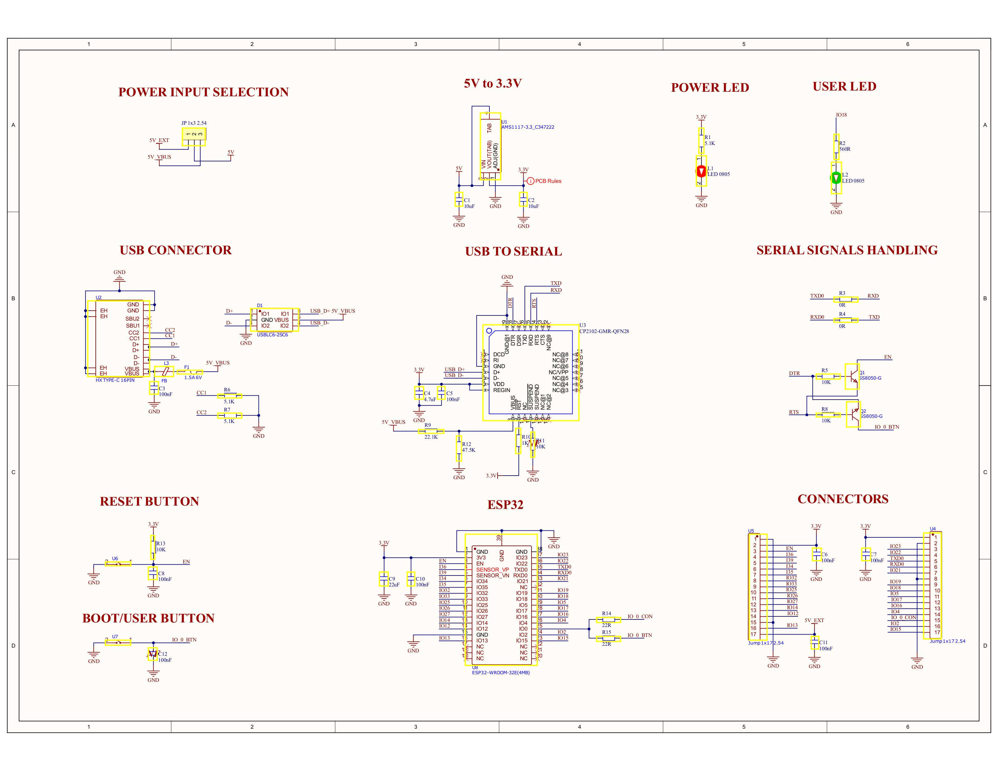
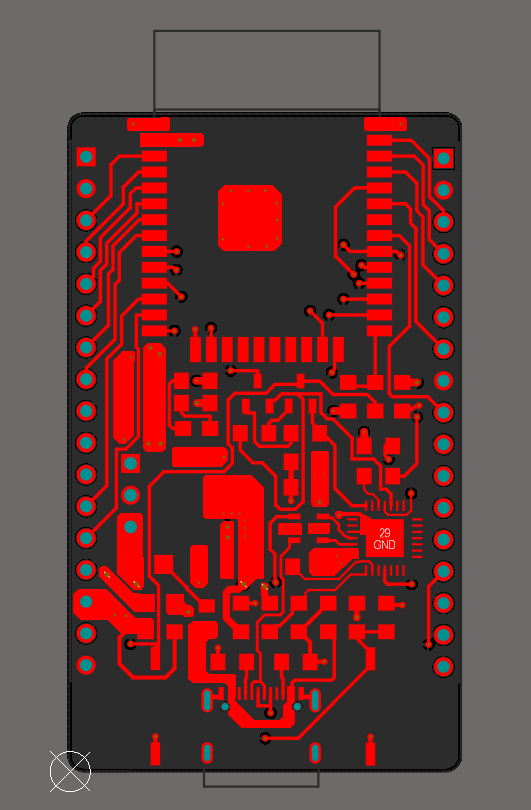
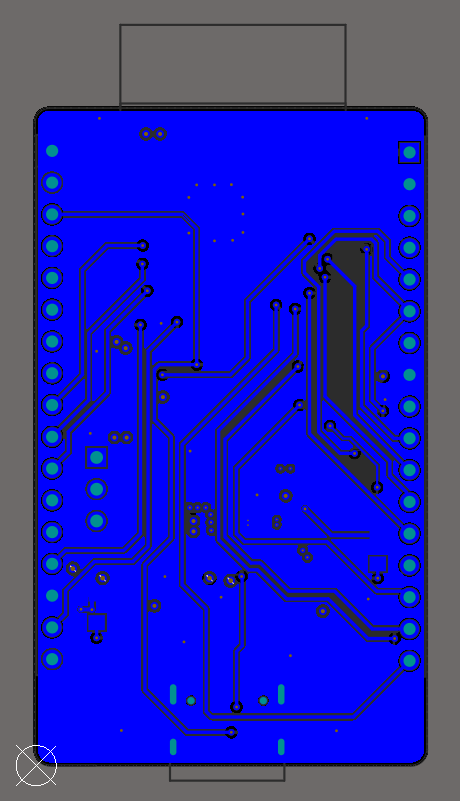
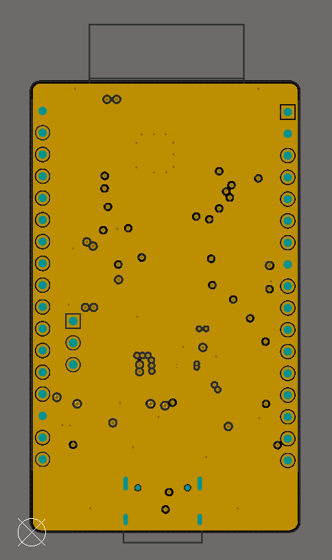
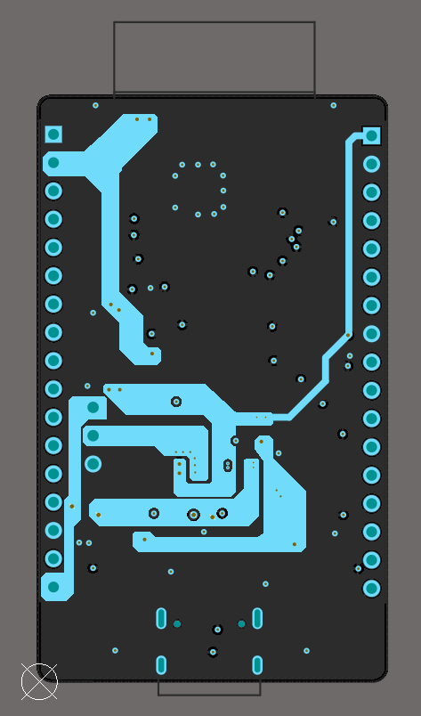
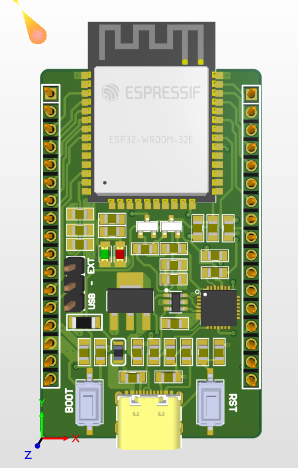
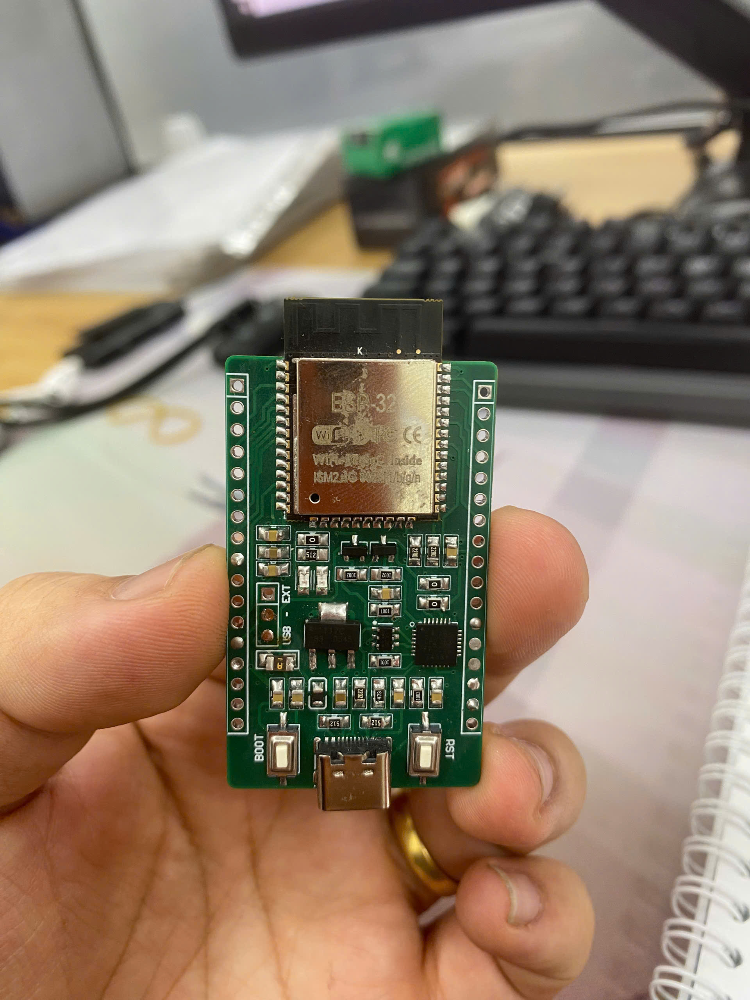

# ESP32 - Board phát triển tự thiết kế

## Lời cảm ơn

Xin gửi lời cảm ơn đặc biệt tới **ông Vũ Đức Tuấn** đã hào phóng tài trợ linh kiện điện tử và chi phí gia công PCB cho dự án này. Board này sẽ không thể hoàn thành nếu không có sự hỗ trợ của ông.

---

## 1. Tổng quan

Đây là một board phát triển ESP32 được thiết kế hoàn toàn từ đầu bằng Altium Designer. Board sử dụng module ESP32-WROOM-32E làm trung tâm và có đầy đủ các mạch cần thiết cho việc nạp chương trình qua USB, ổn áp nguồn và truy cập GPIO. Về ý tưởng, board tương tự các board phát triển thương mại nhưng được thiết kế thủ công hoàn toàn.

---

## 2. Tính năng

- Module ESP32-WROOM-32E (flash 4 MB) làm vi điều khiển chính
- Cổng USB Type-C để cấp nguồn và nạp firmware
- Chip chuyển đổi USB-to-Serial CP2102 để giao tiếp giữa máy tính và ESP32
- Mạch tự động reset dùng transistor NPN SS8050, điều khiển bằng tín hiệu DTR/RTS
- IC ổn áp LDO AMS1117-3.3 (hạ 5V xuống 3.3V, dòng tối đa 1A)
- Chọn nguồn đầu vào bằng jumper (USB VBUS hoặc nguồn 5V ngoài)
- LED báo nguồn (màu đỏ) và LED người dùng có thể lập trình (màu xanh lá, GPIO18)
- Nút Reset (EN) và nút Boot/Flash (GPIO0)
- Hai hàng header mở rộng 17 chân, đưa ra toàn bộ các chân GPIO khả dụng
- PCB 4 lớp, có hai lớp trong dành riêng cho GND và nguồn (PWR)

---

## 3. Sơ đồ nguyên lý

---

## 4. Các lớp PCB

### Lớp trên (Top Layer)

### Lớp dưới (Bottom Layer)

### Lớp GND (Lớp trong 1)

### Lớp nguồn PWR (Lớp trong 2)

### Hình 3D (Altium Designer)

### Sản phẩm sau khi lắp ráp

---

## 5. Tệp dự án

| Tệp / Thư mục | Mô tả |
|---|---|
| `My_esp.SchDoc` | Tệp nguồn sơ đồ nguyên lý (Altium Designer) |
| `My_esp.PcbDoc` | Tệp nguồn layout PCB (Altium Designer) |
| `My_own_esp32(2).PrjPcb` | Tệp dự án Altium Designer |
| `My_own_esp32(2).OutJob` | Cấu hình Output Job (xuất Gerber, file khoan, v.v.) |
| `Project Outputs for My_own_esp32(2)/` | Các file Gerber và file khoan đã xuất, sẵn sàng gửi đi gia công |
| `PDNAnalyzer_Output/` | Kết quả phân tích mạng phân phối nguồn (Power Delivery Network) |
| `Picture/` | Hình ảnh sơ đồ nguyên lý và các lớp PCB |

---

## 6. Công cụ sử dụng

- **Altium Designer** — Vẽ sơ đồ nguyên lý, layout PCB và xuất file Gerber

---

## 7. Bài học rút ra

- **Đọc datasheet linh kiện** — Học cách lấy trực tiếp từ datasheet các mạch ứng dụng mẫu, footprint khuyến nghị và đặc tính điện của các linh kiện như ESP32-WROOM-32E, CP2102, AMS1117 và SS8050.
- **Sử dụng PDN Analyzer** — Có kinh nghiệm thực tế chạy phân tích mạng phân phối nguồn (PDN) trong Altium Designer để kiểm chứng rằng các đường mạch và lớp nguồn cấp đủ dòng với mức sụt áp chấp nhận được trên toàn board.
- **Đổ đồng với P+G (Polygon Pour)** — Học cách dùng tính năng polygon pour của Altium để phủ đồng cho các net nguồn và GND, giúp tăng khả năng chịu dòng, giảm trở kháng trên đường nguồn và cải thiện khả năng che chắn nhiễu điện từ (EMI) cho toàn board.
